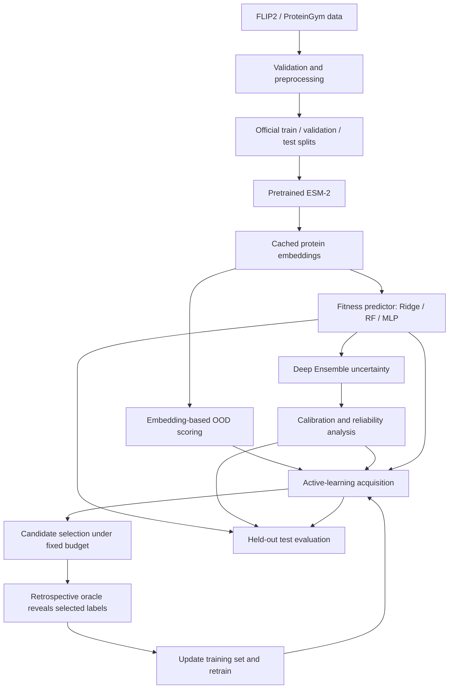

# ProtAL-UQ

**Protein Active Learning with Uncertainty Quantification**  
*Predict. Quantify. Select. Optimize.*

> A research project investigating whether uncertainty-calibrated, distribution-shift-aware active learning can improve protein candidate selection under a limited evaluation budget.

**Project status:** Research prototype / under development  
**Primary language:** Python  
**Primary protein representation model:** ESM-2 (`facebook/esm2_t12_35M_UR50D`)  
**Initial benchmark:** FLIP2 — Alpha Amylase  
**Compute strategy:** Local development + free GPU notebooks where available (Kaggle and Google Colab)

---

## Table of contents

- [1. Overview](#1-overview)
- [2. Research problem](#2-research-problem)
- [3. Research question and hypotheses](#3-research-question-and-hypotheses)
- [4. Proposed approach](#4-proposed-approach)
- [5. Model stack](#5-model-stack)
- [6. Datasets](#6-datasets)
- [7. System workflow](#7-system-workflow)
- [8. Experimental methodology](#8-experimental-methodology)
- [9. Evaluation metrics](#9-evaluation-metrics)
- [10. Technology stack](#10-technology-stack)
- [11. Repository structure](#11-repository-structure)
- [12. Development setup](#12-development-setup)
- [13. GPU and compute strategy](#13-gpu-and-compute-strategy)
- [14. Reproducibility and data-leakage controls](#14-reproducibility-and-data-leakage-controls)
- [15. Current development milestones](#15-current-development-milestones)
- [16. Limitations](#16-limitations)
- [17. References and resources](#17-references-and-resources)

---

## 1. Overview

Protein engineering can produce large candidate spaces, but evaluating every candidate is expensive. A prediction model can estimate a protein variant's fitness, yet its prediction may be unreliable—especially when the candidate differs from the model's training data.

ProtAL-UQ is designed to investigate a practical question: **can a model estimate not only which candidates look promising, but also where its predictions are uncertain, and use that information to choose which candidates should be evaluated next?**

The project combines:

1. Pretrained protein-language-model representations.
2. Supervised protein fitness prediction.
3. Predictive uncertainty estimation.
4. Uncertainty calibration.
5. Out-of-distribution (OOD) or distribution-shift detection.
6. Diversity-aware active-learning selection.
7. Fixed-budget retrospective evaluation.

The initial implementation uses pretrained ESM-2 embeddings and trains task-specific machine-learning models. **ProtAL-UQ does not initially train a protein foundation model from scratch.**

## 2. Research problem

Three practical challenges motivate this project.

### 2.1 Prediction uncertainty

A model may return a fitness estimate without indicating whether that estimate is reliable. Prediction uncertainty can help distinguish candidates the model understands well from candidates that require further evaluation.

### 2.2 Distribution shift

Performance can degrade when evaluation sequences differ from the training data. In protein benchmarks, shifts can involve mutation count, mutation position, mutation identity, protein sequence context, or a different wild-type protein.

### 2.3 Limited evaluation budgets

When only a limited number of candidates can be evaluated, ranking solely by predicted fitness may overlook informative candidates or repeatedly select very similar variants.

## 3. Research question and hypotheses

### Central research question

> Can uncertainty-calibrated, distribution-shift-aware active learning improve protein candidate selection under a fixed evaluation budget compared with conventional selection strategies?

### Research hypotheses

- **H1:** Active-learning strategies can outperform random selection on appropriate protein fitness benchmarks.
- **H2:** Calibrated uncertainty estimates can better reflect prediction error than uncalibrated uncertainty estimates.
- **H3:** Embedding-based shift indicators can identify some candidates for which prediction reliability degrades.
- **H4:** Combining predicted fitness, uncertainty, and sequence diversity can improve selection compared with fitness-only greedy selection.

These are hypotheses to test—not established results. The project will report positive, negative, and inconclusive findings.

## 4. Proposed approach

The initial research pipeline is:

1. Load an experimental protein fitness benchmark and preserve its official splits.
2. Validate sequences and fitness labels.
3. Extract sequence embeddings using a pretrained ESM-2 checkpoint.
4. Train fitness predictors on the training partition.
5. Estimate predictive uncertainty using a Deep Ensemble.
6. Evaluate and, where appropriate, calibrate uncertainty using held-out calibration data.
7. Estimate embedding-space distance from the training distribution.
8. Rank candidates using multiple acquisition strategies.
9. Simulate candidate selection under fixed evaluation budgets.
10. Compare methods using repeated experiments and held-out test data.

The proposed acquisition method will be developed and justified through experiments. Its final mathematical form and component weights are not assumed in advance.

## 5. Model stack

| Component | Initial method | Role |
|---|---|---|
| Protein representation | ESM-2 35M | Convert amino-acid sequences into embeddings |
| Fitness prediction | MLP regressor | Predict assay-specific experimental fitness |
| Prediction baselines | Ridge Regression, Random Forest | Establish simple and nonlinear baselines |
| Uncertainty estimation | Deep Ensemble of MLPs | Estimate model disagreement / predictive uncertainty |
| Alternative uncertainty | MC Dropout | Optional comparison |
| Calibration | Held-out calibration; conformal intervals where appropriate | Assess and improve interval reliability |
| OOD / shift scoring | k-nearest-neighbor embedding distance | Identify candidates distant from training representations |
| Candidate selection | Random, greedy, uncertainty, diversity, proposed hybrid | Compare acquisition strategies |

### ESM-2 checkpoint

Initial checkpoint: [`facebook/esm2_t12_35M_UR50D`](https://huggingface.co/facebook/esm2_t12_35M_UR50D).

This is a pretrained 35-million-parameter ESM-2 checkpoint. Its configuration specifies a hidden dimension of 480. The project will initially keep ESM-2 frozen and train downstream predictors on extracted embeddings. The embedding extraction implementation must correctly handle padding and special tokens.

### Deep Ensemble

The initial ensemble will contain five independently trained MLP predictors, subject to available compute. For predictions \(\hat y_1, \ldots, \hat y_M\), the ensemble mean is:

\[
\bar y = \frac{1}{M}\sum_{m=1}^{M}\hat y_m
\]

Ensemble disagreement can be summarized by:

\[
u_{\text{ens}} = \frac{1}{M}\sum_{m=1}^{M}(\hat y_m-\bar y)^2
\]

This disagreement is an uncertainty indicator; it is not automatically a calibrated probability or a complete estimate of all sources of predictive uncertainty.

## 6. Datasets

### 6.1 Primary benchmark: FLIP2

- Website: <https://flip.protein.properties/>
- Purpose: protein fitness prediction and generalization evaluation.
- Initial task: **Alpha Amylase — `one-to-many` split**.
- Follow-up tasks: other suitable FLIP2 datasets and splits, selected according to the research question and available compute.

FLIP2 contains experimentally measured protein-variant fitness data and predefined splits designed to evaluate different generalization settings. Its split types include shifts related to mutation count, mutation position, mutation identity, and wild-type protein context. Use the official split files rather than replacing them with a random split.

**Initial dataset-selection rule:** begin with Alpha Amylase to validate the complete pipeline. Then expand to additional tasks such as Hydrophobic Core, TrpB, or IRED after checking each task's target definition, split design, data size, and suitability for the chosen regression protocol.

### 6.2 Secondary benchmark: ProteinGym

- Website: <https://proteingym.org/>
- Repository: <https://github.com/OATML-Markslab/ProteinGym>
- Purpose: independent evaluation on selected deep mutational scanning (DMS) assays.

Use compatible experimental DMS assays as separate tasks. Do not combine assay labels indiscriminately: assays can measure different properties and use different scales. Clinical variant benchmarks are not interchangeable with experimental protein-fitness regression tasks.

### 6.3 Data provenance

For every downloaded dataset, record:

- Source URL and retrieval date.
- Dataset name, version, and split name.
- License and attribution requirements.
- Number of sequences and label distribution.
- Preprocessing steps and exclusions.
- Checksums where practical.

Do not commit large raw datasets or model checkpoints to the Git repository. Follow each dataset's license and redistribution terms.

## 7. System workflow



## 8. Experimental methodology

### 8.1 Prediction baselines

Train and compare:

- Ridge Regression.
- Random Forest Regressor.
- MLP Regressor.

Use the same data partitions and comparable preprocessing. Select hyperparameters using training/validation data only.

### 8.2 Uncertainty experiments

Evaluate Deep Ensemble uncertainty and, if compute permits, MC Dropout. Analyze whether higher uncertainty is associated with larger prediction errors. Report calibration results separately from raw uncertainty scores.

### 8.3 Distribution-shift experiments

Use biologically meaningful benchmark splits. Describe each shift precisely—for example, mutation-count shift or wild-type transfer—instead of treating every held-out split as the same kind of OOD problem.

Fit OOD scoring methods using training embeddings only. Evaluate shift detection against the predefined split membership and analyze predictive performance as a function of the OOD score.

### 8.4 Retrospective active-learning simulation

For a fair offline simulation:

1. Keep the official test partition untouched for final evaluation.
2. Use the training partition as the acquisition pool.
3. Create a small initial labeled subset from that training partition.
4. Hide labels for the remaining pool candidates from the acquisition algorithm.
5. Select a batch using an acquisition strategy.
6. Reveal labels only for selected candidates and add them to the labeled training set.
7. Retrain or update the model and repeat until the evaluation budget is exhausted.
8. Use validation data for model selection and calibration; do not use test labels to tune acquisition rules.

This is a retrospective simulation using existing experimental measurements as an offline oracle. It is **not** a live laboratory active-learning loop and does not establish that model predictions correspond to experimentally validated biological function.

### 8.5 Selection strategies

Compare at least:

- Random selection.
- Greedy predicted-fitness selection.
- Uncertainty-only selection.
- Diversity-only selection.
- Proposed uncertainty-aware, diversity-aware selection.

All methods must use the same candidate pool, initial labeled set, batch sizes, total budget, and random seeds.

### 8.6 Ablation studies

Remove or disable individual components to measure their contribution:

- No uncertainty term.
- No diversity term.
- No OOD information.
- Uncalibrated versus calibrated uncertainty.
- Alternative acquisition strategies.

Run repeated seeds and report uncertainty intervals or statistical comparisons where appropriate.

## 9. Evaluation metrics

| Evaluation area | Metrics / analysis |
|---|---|
| Fitness prediction | Spearman correlation, MAE, RMSE |
| Predictive uncertainty | Negative Log-Likelihood when a valid predictive distribution is defined; error–uncertainty analysis |
| Calibration | Prediction interval coverage and width; calibration diagnostics |
| OOD detection | AUROC, AUPRC, and FPR at a stated TPR when split membership provides valid labels |
| Candidate selection | Mean selected fitness, top-k enrichment / hit rate, selection regret |
| Diversity | Pairwise sequence identity or another explicitly defined diversity measure |
| Efficiency | Runtime, memory use, number of revealed oracle labels, performance versus evaluation budget |

Report metric definitions, direction of improvement, target transformations, and assay-specific caveats. Do not compare raw fitness scores across unrelated assays without a justified normalization procedure.

## 10. Technology stack

| Area | Tools |
|---|---|
| Language | Python 3.11+ |
| Deep learning | PyTorch |
| Pretrained model integration | Hugging Face Transformers |
| Machine learning | scikit-learn |
| Data processing | NumPy, Pandas, SciPy |
| Bioinformatics | Biopython |
| Notebooks | Jupyter |
| Visualization | Matplotlib, Plotly |
| Experiment tracking | MLflow (planned) |
| Testing | pytest |
| Version control | Git and GitHub |
| Optional research UI | Streamlit |
| Optional packaging | Docker |

## 11. Repository structure

The repository will grow as modules are implemented. The planned structure is:

```text
ProtAL-UQ/
├── README.md
├── requirements.txt
├── pyproject.toml
├── .gitignore
├── configs/
│   ├── data.yaml
│   ├── model.yaml
│   ├── uncertainty.yaml
│   └── experiment.yaml
├── data/
│   ├── raw/                 # Not committed
│   ├── processed/           # Not committed
│   └── splits/
├── notebooks/
│   ├── 01_environment_check.ipynb
│   ├── 02_dataset_exploration.ipynb
│   ├── 03_esm2_embeddings.ipynb
│   ├── 04_fitness_baselines.ipynb
│   └── 05_uncertainty_and_active_learning.ipynb
├── src/
│   └── protal_uq/
│       ├── data/
│       ├── embeddings/
│       ├── prediction/
│       ├── uncertainty/
│       ├── ood/
│       ├── active_learning/
│       ├── evaluation/
│       └── utils/
├── artifacts/               # Not committed
│   ├── embeddings/
│   └── models/
├── experiments/
├── results/
│   ├── metrics/
│   ├── figures/
│   └── reports/
├── tests/
└── docs/
```

## 12. Development setup

### Requirements

- Windows, Linux, or macOS.
- Python 3.11 or a compatible Python 3 version supported by the installed dependencies.
- Git.
- VS Code or another Python IDE.
- Internet access for downloading datasets and pretrained model files.
- A GPU is helpful for embedding extraction but is not required for basic CPU development.

### Clone the repository

```bash
git clone https://github.com/<YOUR_GITHUB_USERNAME>/ProtAL-UQ.git
cd ProtAL-UQ
```

### Create and activate a virtual environment

**Windows PowerShell:**

```powershell
py -3.11 -m venv .venv
.\.venv\Scripts\Activate.ps1
python -m pip install --upgrade pip
```

**Linux / macOS:**

```bash
python3.11 -m venv .venv
source .venv/bin/activate
python -m pip install --upgrade pip
```

### Install PyTorch

Install the PyTorch build that matches your execution environment. For CPU-only local development, use the official PyTorch selector and choose the CPU build:

<https://pytorch.org/get-started/locally/>

For Kaggle or Colab, first inspect the preinstalled PyTorch and CUDA environment. Avoid reinstalling PyTorch unless a compatible version is actually required.

### Install project dependencies

Once `requirements.txt` is maintained for the project, install with:

```bash
python -m pip install -r requirements.txt
```

The initial dependency set is expected to include:

```bash
python -m pip install numpy pandas scipy scikit-learn biopython transformers safetensors jupyter ipykernel matplotlib plotly pyyaml tqdm pytest
```

### Verify the environment

```python
import torch
import numpy
import pandas
import sklearn
import transformers

print("PyTorch:", torch.__version__)
print("CUDA available:", torch.cuda.is_available())
print("Environment verification passed.")
```

## 13. GPU and compute strategy

The project is designed to begin with free or locally available compute. Free-tier GPU access is subject to provider availability, quotas, and session limits; it is not guaranteed.

| Environment | Intended use |
|---|---|
| Local Windows/Linux PC | Coding, preprocessing, tests, small ML experiments |
| Kaggle Notebooks | Primary free-GPU option for ESM-2 inference and experiments when GPU is available |
| Google Colab | Additional / backup notebook GPU environment when available |
| GitHub | Source control, issue tracking, documentation, and collaboration—not the project's general-purpose free GPU machine |

### Compute practices

- Start with the 35M-parameter ESM-2 checkpoint.
- Use batches sized for the currently available GPU memory.
- Cache embeddings and avoid recomputing them unnecessarily.
- Save checkpoints and experiment outputs frequently.
- Keep raw data and large model artifacts outside normal Git commits.
- Log the GPU type, package versions, run configuration, and random seeds.
- Use CPU for small preprocessing, tests, and many classical ML tasks.

## 14. Reproducibility and data-leakage controls

Reproducibility is a core project requirement.

- Preserve the official benchmark splits and document any additional splits.
- Fit scalers, feature transformations, and data-dependent preprocessing on training data only.
- Use validation or a separate calibration partition for model selection and calibration.
- Do not use test labels to tune models, calibrators, OOD thresholds, acquisition weights, or stopping rules.
- In active-learning simulation, reveal candidate-pool labels only after the acquisition strategy selects those candidates.
- Keep the final test set outside the acquisition loop unless the benchmark protocol explicitly defines a different evaluation design.
- Check duplicate sequences and sequence-similarity leakage where appropriate.
- Fix and record random seeds; repeat stochastic experiments across multiple seeds.
- Save configurations, metrics, model checkpoints, and software versions for each run.

## 15. Current development milestones

The project is under development. The intended order is:

- [ ] **M1 — Environment:** Python environment, Git repository, local tests, Kaggle / Colab notebook setup.
- [ ] **M2 — Dataset:** Download and inspect FLIP2 Alpha Amylase; preserve official splits; validate sequences and labels.
- [ ] **M3 — Embeddings:** Load ESM-2 35M, implement correct batched embedding extraction, and cache embeddings.
- [ ] **M4 — Prediction baseline:** Train Ridge Regression, Random Forest, and MLP; report held-out metrics.
- [ ] **M5 — Uncertainty:** Implement a Deep Ensemble and analyze uncertainty versus prediction error.
- [ ] **M6 — Calibration and shift:** Evaluate calibration and embedding-based shift detection.
- [ ] **M7 — Active learning:** Implement selection baselines and a leakage-safe retrospective simulator.
- [ ] **M8 — Research evaluation:** Run fixed-budget comparisons, ablations, repeated seeds, and statistical analysis.
- [ ] **M9 — Expansion:** Evaluate additional FLIP2 tasks and selected ProteinGym DMS assays.
- [ ] **M10 — Reporting:** Publish reproducible results, documentation, limitations, and research conclusions.

## 16. Limitations

- This project initially uses retrospective benchmark evaluation, not wet-lab experiments.
- An experimental fitness label is assay-specific and should not be interpreted as a universal measure of protein function.
- High predicted fitness does not establish biological activity, safety, stability, or experimental success.
- Ensemble disagreement is not automatically calibrated uncertainty.
- Embedding distance is a proxy for distribution shift, not proof that a sequence is biologically novel or out of distribution in every relevant sense.
- Results on one protein family or assay may not generalize to other proteins or experimental settings.
- Strong scientific claims require appropriate baselines, repeated experiments, transparent limitations, and ideally independent experimental validation.

ProtAL-UQ is a computational research and benchmarking project. Its predictions are not substitutes for experimental validation or expert biological assessment.

## 17. References and resources

### Benchmarks and biological data

- [FLIP2 benchmark](https://flip.protein.properties/)
- [ProteinGym](https://proteingym.org/)
- [ProteinGym GitHub repository](https://github.com/OATML-Markslab/ProteinGym)
- [UniProt](https://www.uniprot.org/)
- [RCSB Protein Data Bank](https://www.rcsb.org/)

### Protein language models and software

- [ESM-2 35M on Hugging Face](https://huggingface.co/facebook/esm2_t12_35M_UR50D)
- [Evolutionary Scale Modeling (ESM) GitHub repository](https://github.com/facebookresearch/esm)
- [PyTorch](https://pytorch.org/)
- [Hugging Face Transformers](https://huggingface.co/docs/transformers/index)
- [scikit-learn](https://scikit-learn.org/)
- [Biopython](https://biopython.org/)

### Compute and development

- [Kaggle Notebooks](https://www.kaggle.com/code)
- [Google Colab](https://colab.research.google.com/)
- [GitHub](https://github.com/)
- [VS Code](https://code.visualstudio.com/)

---

## Project vision

**ProtAL-UQ — Protein Active Learning with Uncertainty Quantification**

Investigate whether protein-language-model representations, calibrated predictive uncertainty, distribution-shift awareness, and diversity-aware active learning can make protein candidate evaluation more informative under limited evaluation budgets.

**Predict. Quantify. Select. Optimize.**
